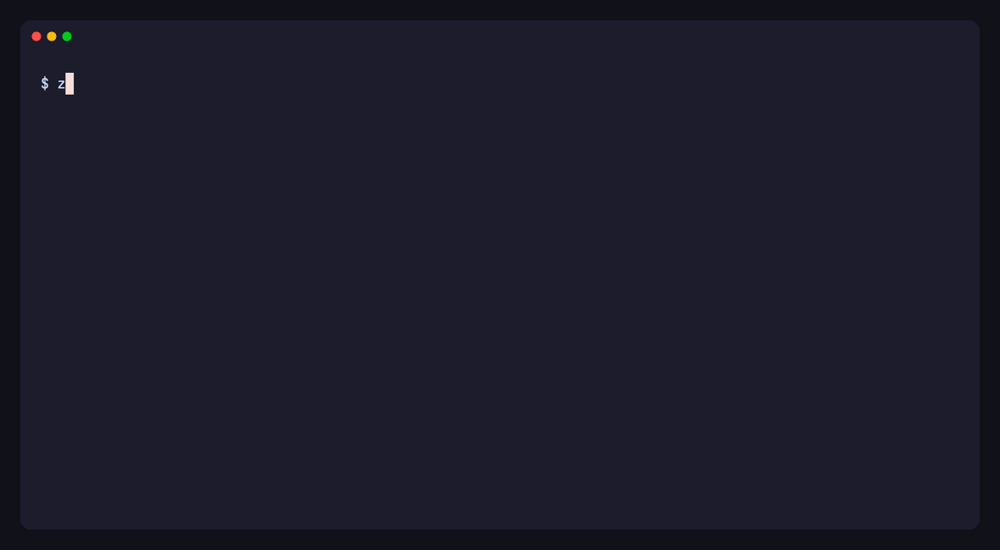

# Chroma Logger

[](https://github.com/adia-dev/chroma-logger-zig/actions/workflows/ci.yml)
[](https://ziglang.org/)
[](#project-status)
[](LICENSE)

Chroma Logger is a configurable, comptime-first ANSI logger for Zig. It plugs
directly into `std.log`, adds readable timestamps, levels, and scopes, and uses
[Chroma](https://github.com/adia-dev/chroma-zig) to compile message styles into
ANSI and plain-text variants without runtime parsing or allocation.

[](docs/assets/chroma-logger-demo.mp4)

The animation above is a real `zig build run` session captured by VHS. Click it
for the MP4 version.

## Project status

`0.2.0-rc.1` is an experimental release candidate. It is a good fit for CLI
tools, development utilities, and applications with modest logging volume. The
API may still change in response to real-world feedback before a stable 0.2
release.

Chroma Logger is not currently intended for high-throughput or
latency-sensitive logging workloads. It writes synchronously to locked stderr;
each enabled record still reads the clock, formats runtime arguments, and
performs I/O before returning. Comptime rendering removes message-template and
style parsing from that path, but it does not make the output operation free.

## Features

- Drop-in `std.Options.logFn` integration.
- Typed compile-time configuration, including direct `.zon` imports.
- Automatic ANSI or plain output with `NO_COLOR` and `CLICOLOR_FORCE` support.
- Configurable timestamps, fixed UTC offsets, labels, scopes, spacing, and
  level width.
- Typed themes for timestamps, scopes, and every log level.
- Chroma semantic styles and custom formatting grammar inside messages.
- A deterministic writer API for files, memory buffers, tests, and custom
  application sinks.
- Atomic stderr writes protected by Zig's debug-output lock.
- Clear compile-time failures for malformed logger and Chroma configuration.
- Tested on Linux, macOS, and Windows with Zig 0.16.0.

## Installation

Add the package to `build.zig.zon`:

```sh
zig fetch --save=chroma_logger https://github.com/adia-dev/chroma-logger-zig/archive/refs/tags/v0.2.0-rc.1.tar.gz
```

Import its module in `build.zig`:

```zig
const logger_dep = b.dependency("chroma_logger", .{
    .target = target,
    .optimize = optimize,
});
exe.root_module.addImport(
    "chroma-logger",
    logger_dep.module("chroma-logger"),
);
```

Chroma Logger is a Zig module, so there is no runtime library to link.

## Quick start

Create a configured logger type and give its `log` function to `std.log`:

```zig
const std = @import("std");
const chroma_logger = @import("chroma-logger");

const AppLogger = chroma_logger.Logger(.{});

pub const std_options: std.Options = .{
    .log_level = .debug,
    .logFn = AppLogger.log,
};

pub fn main() void {
    std.log.info("Server listening on {#bold,bright-green}{s}{#reset}", .{
        "http://127.0.0.1:8080",
    });

    const database_log = std.log.scoped(.database);
    database_log.warn("Query took {#bright-yellow}{d}ms{#reset}", .{240});
}
```

The default layout looks like this in plain output:

```text
12:34:56  INFO   Server listening on http://127.0.0.1:8080
12:34:56  WARN   [database]  Query took 240ms
```

For the default configuration, `chroma_logger.log` is a shorter equivalent to
`chroma_logger.Logger(.{}).log`.

## Configure from ZON

Configuration remains typed and compile-time checked when it lives in a file:

```zig
const AppLogger = chroma_logger.Logger(@import("logger.zon"));
```

```zig
// logger.zon
.{
    .utc_offset_minutes = 60,
    .layout = .{
        .timestamp = .date_time,
        .scope = .non_default,
        .separator = "  ",
    },
    .labels = .{
        .err = "FAIL",
        .info = "READY",
    },
    .theme = .{
        .err = .{
            .foreground = .{ .rgb = .{ .r = 255, .g = 92, .b = 117 } },
            .effects = .{.bold},
        },
        .info = .{
            .foreground = .{ .rgb = .{ .r = 80, .g = 250, .b = 123 } },
            .effects = .{.bold},
        },
    },
    .message_format = .{
        .styles = .{
            .{
                .name = "value",
                .style = .{
                    .foreground = .{ .bright = .cyan },
                    .effects = .{.bold},
                },
            },
        },
    },
}
```

The file is imported by Zig during compilation. Chroma Logger never opens or
parses a configuration file while the application is running. See
[`examples/logger.zon`](examples/logger.zon) for the complete demo theme.

## Configuration reference

| Field | Default | Purpose |
| --- | --- | --- |
| `color` | `.auto` | Select automatic, always-ANSI, or never-ANSI output |
| `utc_offset_minutes` | `0` | Apply a fixed offset to UTC timestamps |
| `layout.timestamp` | `.time` | Use `.none`, `.time`, or `.date_time` |
| `layout.show_level` | `true` | Include the level label |
| `layout.scope` | `.non_default` | Use `.never`, `.non_default`, or `.always` |
| `layout.separator` | `"  "` | Separate timestamp, level, scope, and message |
| `layout.scope_open` / `scope_close` | `"["` / `"]"` | Delimit scope names |
| `layout.level_width` | `5` | Right-pad short level labels by UTF-8 byte length |
| `labels` | Standard names | Rename `ERROR`, `WARN`, `INFO`, and `DEBUG` |
| `theme` | Built-in palette | Style timestamps, scopes, and levels with typed Chroma styles |
| `message_format` | Chroma defaults | Configure semantic styles and message grammar |

Fixed UTC offsets are explicit and deterministic. Chroma Logger does not read
the host timezone database or attempt daylight-saving conversion.

## What happens at comptime?

| Operation | Phase | Runtime allocation or parsing? |
| --- | --- | --- |
| Import and type-check logger or ZON configuration | Comptime | No |
| Validate labels, layout, theme, and Chroma grammar | Comptime | No |
| Parse Chroma directives in each message | Comptime | No |
| Generate ANSI and plain message variants | Comptime | No |
| Generate ANSI fragments for levels, scopes, and timestamps | Comptime | No |
| Apply `std.log` level filtering | Comptime | No |
| Read the clock and apply the fixed UTC offset | Runtime | No allocation |
| Select ANSI or plain output from terminal capability | Runtime | One boolean branch |
| Substitute Zig formatting arguments | Runtime | Handled by `std.fmt` |
| Lock and write one complete line | Runtime | Buffered, no allocation |

When timestamps are disabled, the clock read and date conversion are removed
from that logger at compile time.

## Current limitations

- Only the synchronous stderr console provider is built in.
- Log calls are serialized by Zig's debug-output lock.
- There is no batching, background writer, bounded queue, or backpressure
  policy.
- Structured fields and event IDs are not preserved after text formatting.
- File rotation, JSON Lines, syslog, and multi-provider fan-out are not yet
  implemented.
- Timezone support is a fixed UTC offset without daylight-saving or timezone
  database lookup.
- Benchmarks currently guard compile-time regressions; they are not evidence
  that the logger is suitable for performance-critical production workloads.

For very frequent events or strict tail-latency requirements, use a dedicated
buffered or structured logging system and keep Chroma Logger for human-facing
console output until the provider work below lands.

## Experimental roadmap

The next design phase is planned as opt-in experimental APIs so the small
console logger can remain straightforward:

1. A provider pipeline that separates records, formatters, and destinations.
2. Structured fields, event IDs, and JSON Lines output.
3. A rotating file provider with explicit flush and failure policies.
4. Bounded buffering with configurable blocking, dropping, or synchronous
   fallback behavior.
5. Diagnostic circular buffering that flushes recent context after an error.
6. RFC 5424 syslog formatting followed by optional UDP and TCP transports.

Provider topology, message schemas, formats, and buffer capacities should stay
compile-time configured. File paths, network addresses, open handles, and queue
state necessarily remain runtime concerns.

## Color behavior

`color = .auto` uses Zig's detected stderr terminal mode. It produces plain
text for redirection and `NO_COLOR`, honors `CLICOLOR_FORCE`, and enables ANSI
escape support on modern Windows terminals when possible.

Use `.always` for controlled environments such as a terminal recording, or
`.never` for logs intended exclusively for files and parsers.

## Custom writers and deterministic tests

Every configured logger exposes `write` in addition to the `std.log` adapter:

```zig
const TestLogger = chroma_logger.Logger(.{
    .layout = .{ .timestamp = .none },
});

var bytes: [256]u8 = undefined;
var writer: std.Io.Writer = .fixed(&bytes);

try TestLogger.write(
    &writer,
    0, // Unix seconds supplied by the caller
    false, // plain output
    .info,
    .database,
    "connected in {d}ms",
    .{12},
);
```

This path returns writer errors instead of swallowing them. The `std.log`
adapter follows Zig's conventional `void` signature and ignores stderr write
failures after safely releasing the lock.

## Migration from 0.1

Version 0.2 RC is a redesign for Zig 0.16 and Chroma 0.2.

| Previous API | Version 0.2 |
| --- | --- |
| `ChromaLogger.log` | `chroma_logger.log` or `Logger(.{}).log` |
| `ChromaLogger.timeBasedLog` | `Logger(.{ .layout = .{ .timestamp = .date_time } }).log` |
| `ChromaLogger.defaultLog` | Configure `timestamp`, `show_level`, and `scope` off |
| `{red}` inside a message | `{#red}` |
| `{241}` inside a message | `{#fg:241}` |
| Hard-coded UTC+1 timestamp | Configurable `utc_offset_minutes` |

Scopes are no longer discarded, and automatic mode no longer writes ANSI
codes into redirected output.

## Live example and video

Run the complete themed example:

```sh
zig build run
```

Use `NO_COLOR=1 zig build run` to inspect its precomputed plain variant.

The terminal animation is generated from the real command by
[`docs/demo.tape`](docs/demo.tape):

```sh
vhs validate docs/demo.tape
vhs docs/demo.tape
```

The tape produces both
[`chroma-logger-demo.gif`](docs/assets/chroma-logger-demo.gif) and
[`chroma-logger-demo.mp4`](docs/assets/chroma-logger-demo.mp4).

## Development

Use Zig 0.16.0:

```sh
zig build
zig build run
zig build test
zig build benchmark -Doptimize=ReleaseFast
zig fmt --check .
```

CI repeats tests on Linux, macOS, and Windows and cross-builds common targets.

## License

Chroma Logger is available under the [MIT License](LICENSE).
